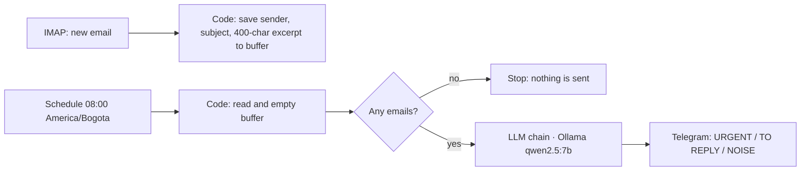

# AI email digest → Telegram (local LLM)

Get **one daily message** instead of checking your inbox all day.

## Why it is built this way
- **Privacy:** the model runs locally with Ollama, so email content never goes to a third-party API.
- **Cheap:** no per-token cost; works on a normal laptop.
- **Safe:** read-only IMAP; the workflow never sends or deletes email.
- **Quiet:** if there were no emails, nothing is sent.

## Setup
1. Install [Ollama](https://ollama.com) and run `ollama pull qwen2.5:7b`.
2. Import `workflow.json` into n8n (`npx n8n` is enough to try it).
3. Credentials: IMAP (app password), Ollama (`http://localhost:11434`), Telegram bot token.
4. Replace `PON_AQUI_TU_CHAT_ID` with your Telegram chat id.
5. Test with **Execute workflow**, then activate.

The prompt (Spanish) asks the model for at most 12 lines: urgent items, items to reply to, and a one-line noise count.
